*"Nothing in life is to be feared. It is only to be understood."* 
— Maria Skłodowska-Curie

 

 

## Hey, I'm Pietro

I'm a Computer Science student at **Cracow University of Technology** and a Junior Java Developer. I care about understanding how things work, not just making them run, but knowing *why* they do.

- Based in **Cracow, Poland**
- Currently exploring **Audio, Web3, ML**
- Always open to interesting projects and collaboration

 

  

&nbsp;

  

<i>I might do a crappy job, but who does any better?</i>

